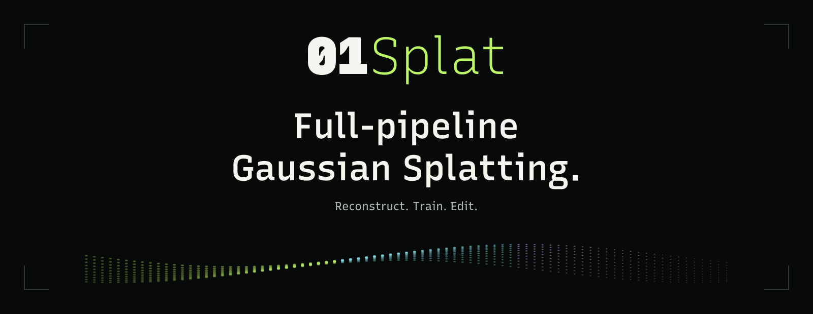

  

<h1 align="center">01Splat</h1>

  <strong>Full-Pipeline Gaussian Splatting Studio</strong> 
  Reconstruct, train and edit Gaussian scenes on your machine.

  <strong><a href="https://01splat.com/download/">Download for Windows</a></strong>
  &nbsp; · &nbsp; <a href="https://01splat.com/">Website</a>
  &nbsp; · &nbsp; <a href="https://01splat.com/docs/">User guide</a>
  &nbsp; · &nbsp; <a href="https://01splat.com/pricing/">License</a>

English · <a href="README.zh-CN.md">简体中文</a>

01Splat brings single-image spatial reconstruction, camera alignment, geometry constraints, Gaussian Splatting training and scene editing into one desktop application. Start with images, video, 360° recordings or a prepared camera dataset, then work through reconstruction, training and editing in the same workspace.

**Native GPU processing · Live training preview · Local projects**

## Reconstruct for your input

Generate a spatial scene from a single image, or reconstruct from multiple views. Photo and video inputs pass through preparation and camera alignment; a compatible, already-solved COLMAP dataset can go straight to training.

Reconstruction settings belong to each Splat object:

| Type | Use |
| :--- | :--- |
| **Spatial** | Single-image spatial reconstruction. This is a generation step, not multi-view training. |
| **General** | Multi-view reconstruction for objects, portraits or environments. It is not restricted to object captures. |
| **Environment** | Environment reconstruction with compatible geometry guidance. The selected training configuration must support the enabled constraints. |

### Supported input routes

| Input | Preparation route |
| :--- | :--- |
| **Single image** | Import an image and generate a Spatial reconstruction. |
| **Photo set** | Prepare images, align cameras and reconstruct the scene. |
| **Ordinary video** | Prepare frames for camera alignment and multi-view reconstruction. |
| **360° video / panorama** | Use the 360° preparation route before reconstruction. |
| **Supported INSV recording** | Use recording-specific preparation, distinct from generic 360° video. |
| **Prepared COLMAP dataset** | Import camera calibration, registered poses and sparse points, then associate the original images. Skip camera alignment. |

Automatic image/video alignment and people masking are part of the published workflow. Input availability depends on the installed version and plan. See the [input guide](https://01splat.com/docs/#inputs) and [release center](https://01splat.com/download/) for supported formats.

## A full-pipeline desktop workflow

For photo and video reconstruction, 01Splat manages the processing stages:

1. **Input Preparation**: prepare the selected media for reconstruction.
2. **Camera Alignment & Reconstruction**: recover cameras and scene structure.
3. **Geometry Constraints**: add compatible geometry guidance where the reconstruction route calls for it.
4. **Gaussian Splatting Training**: choose a training profile and configure the run.
5. **Scene Editing & Export**: inspect, edit, save and export the Gaussian scene.

These are input-dependent routes, not a graph you need to assemble. Single-image Spatial takes its own generation route; solved COLMAP data skips alignment. Geometry guidance requires a compatible training configuration.

## Train with a live viewport

Watch the scene develop during training and navigate the viewport without stopping the run. Display controls show or hide **splats, sparse points, capture cameras, axes and the grid**. Hiding a display layer does not pause training.

Set the controls that matter before starting:

- **Image resolution**: enable a longest-edge limit in pixels, or leave the limit disabled. Aspect ratio is preserved.
- **Maximum splat count**: set a ceiling, not a target. Higher limits can require more GPU memory and disk space.
- **Stopping condition**: choose the training step count, with the unit shown beside the field.
- **Keep training context**: retain the complete Gaussian training state if you want to continue the same run later.

Pause saves the complete training state. Resume continues within the same Splat object; reset starts again within that object. Retained training context covers Gaussian training, not earlier capture preparation or camera reconstruction.

[Training and preview guide](https://01splat.com/docs/#training)

## Keep sources and results together

Sources, Splat objects and folders share one scene tree. Starting a run from a source creates a linked result beneath it. Train several versions with different settings, then move results into folders or the scene root without losing their source relationships.

Save whenever you choose. Importing, generating and training do not require a saved project first. A local **`.01splat` project** stores the scene, reconstruction results, settings and any retained training context. Original source media stay external.

Export a Gaussian scene for another viewer or application, and keep the project for further edits. A PLY export is a result, not a complete training checkpoint.

[Scene organization](https://01splat.com/docs/#scene) · [Projects and working data](https://01splat.com/docs/#projects) · [Export](https://01splat.com/docs/#export)

## Processing stays on your machine

Reconstruction, training and scene processing run locally. Your captures and projects are not uploaded for processing. Sign-in and license checks use online services; billing and update downloads do too.

The global work folder holds computation data. Choose a drive with enough room for prepared inputs, training state and results, and keep the original media accessible.

## 4D Gaussian Splatting: upcoming

Time-varying Gaussian scenes, temporal playback and free-viewpoint navigation are an upcoming direction, not a currently available feature. Using video to reconstruct a static 3D scene is not the same as reconstructing motion in 4D.

## License

01Splat is proprietary software. Free is licensed for non-commercial use; Pro permits commercial use. Both require sign-in and a valid license. See the [website](https://01splat.com/pricing/) for plans and [Terms / EULA](https://01splat.com/legal/terms.html) for the full terms. Application source code is not included in this repository.

## Download and get started

01Splat is a **Windows x64 desktop application**. A compatible GPU and current graphics drivers are required; available profiles and scene size depend on your hardware and working-disk capacity.

1. [Download the Windows installer](https://01splat.com/download/) and review the release requirements.
2. Sign in, then import a source and check its input summary.
3. Choose reconstruction and training settings, then generate or train.

The [quick-start guide](https://01splat.com/docs/#quick-start) covers the first run. Installers, version notes and checksums are maintained on the website.

## Feedback

- [Report a bug](https://github.com/Onceness/01Splat/issues/new?template=bug_report.yml)
- [Suggest a feature](https://github.com/Onceness/01Splat/issues/new?template=feature_request.yml)
- [Report input or hardware compatibility](https://github.com/Onceness/01Splat/issues/new?template=capture_compatibility.yml)

English and Chinese reports are welcome. Include the application version, input type and steps to reproduce. Issues are public: do not post confidential captures, credentials or license data. For private support or security concerns, contact [support@01splat.com](mailto:support@01splat.com).

---

Product and technical information here follows **[01splat.com](https://01splat.com/)**. The website is the reference for current availability, requirements, plans and updates. This repository is for product information and community feedback.
