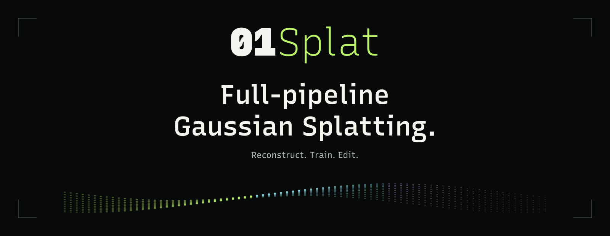

  

<h1 align="center">01Splat</h1>

  <strong>Full-Pipeline Gaussian Splatting Studio</strong> 
  在本机重建、训练和编辑 Gaussian 场景。

  <strong><a href="https://01splat.com/download/">下载 Windows 版</a></strong>
  &nbsp; · &nbsp; <a href="https://01splat.com/">官网</a>
  &nbsp; · &nbsp; <a href="https://01splat.com/docs/">使用指南</a>
  &nbsp; · &nbsp; <a href="https://01splat.com/pricing/">License</a>

<a href="README.md">English</a> · 简体中文

01Splat 将单图空间重建、相机对齐、几何约束、Gaussian Splatting 训练和场景编辑放在同一个桌面软件中。可以从图片、视频、360° 录制或已解算的相机数据集开始，在同一个工作区完成重建、训练与编辑。

**原生 GPU 计算 · 训练实时预览 · 本地工程**

## 按素材选择重建方式

从单张图片生成空间场景，或从多个视角进行重建。照片和视频先经过素材准备与相机对齐；兼容且已经解算完成的 COLMAP 数据集可以直接进入训练。

重建设置属于每个 Splat 对象：

| 类型 | 用途 |
| :--- | :--- |
| **Spatial** | 单图空间重建，属于生成步骤，不是多视角训练。 |
| **General** | 适合物体、人像或环境的多视角重建，不限于物体素材。 |
| **Environment** | 使用兼容几何引导的环境重建。选定的训练配置必须支持所开启的约束。 |

### 输入类型与处理路线

| 输入 | 处理路线 |
| :--- | :--- |
| **单张图片** | 导入图片，生成 Spatial 重建结果。 |
| **照片集** | 准备图像，完成相机对齐与场景重建。 |
| **普通视频** | 准备视频帧，用于相机对齐和多视角重建。 |
| **360° 视频／全景素材** | 先经过 360° 素材准备，再进入重建。 |
| **支持的 INSV 录制** | 使用对应录制格式的准备路线，与通用 360° 视频不同。 |
| **已解算的 COLMAP 数据集** | 导入相机标定、已注册位姿及稀疏点，并关联原始图像，跳过相机对齐。 |

官网公开的流程包含图像／视频自动对齐及自动人物遮罩。具体输入支持取决于安装版本和方案，可查看[输入指南](https://01splat.com/docs/#inputs)与[下载中心](https://01splat.com/download/)。

## 完整的桌面处理流程

对于照片和视频重建，01Splat 管理以下处理阶段：

1. **Input Preparation（素材准备）**：将选定素材准备为重建输入。
2. **Camera Alignment & Reconstruction（相机对齐与重建）**：恢复相机与场景结构。
3. **Geometry Constraints（几何约束）**：在需要的重建路线中加入兼容的几何引导。
4. **Gaussian Splatting Training（Gaussian Splatting 训练）**：选择训练配置并设置本次任务。
5. **Scene Editing & Export（场景编辑与导出）**：检查、编辑、保存并导出 Gaussian 场景。

软件根据输入管理处理路线，无需自行搭建节点图。单图 Spatial 有独立的生成路线；已解算的 COLMAP 数据跳过相机对齐。几何引导需要兼容的训练配置。

## 一边训练，一边查看

训练过程中可以查看场景的变化，并继续操作视窗。显示开关可分别控制 **Splat、稀疏点、拍摄相机、坐标轴和网格**。隐藏显示元素不等于暂停训练。

开始前可以调整这些设置：

- **图像分辨率**：先开启限制，再输入最长边像素数；也可以关闭限制。图像宽高比保持不变。
- **最大 Splat 数量**：这是上限，不是目标数量。更高的上限可能需要更多显存和磁盘空间。
- **停止条件**：设置训练步数，单位显示在输入框旁。
- **保留训练上下文**：如需以后继续同一次训练，开始前选择保留完整的 Gaussian 训练状态。

暂停时保存完整训练状态；恢复和重置都在同一个 Splat 对象内进行。保留的训练上下文仅指 Gaussian 训练，不包括此前的素材准备或相机重建。

[训练与预览指南](https://01splat.com/docs/#training)

## 统一管理来源与结果

素材来源、Splat 对象和文件夹在同一个场景树中。从来源启动任务后，结果默认生成在其下方并保留关联。同一来源可以使用不同设置生成多个版本；把结果移到文件夹或场景根层级，也不会丢失来源关系。

可以随时保存。导入、生成和训练都不要求先保存工程。本地 **`.01splat` 工程**保存场景、重建结果、设置及选择保留的训练上下文，原始素材仍放在外部。

需要在其他查看器或软件中使用时，可以导出 Gaussian 场景，并保留工程用于后续编辑。PLY 导出是结果文件，不是完整训练断点。

[场景组织](https://01splat.com/docs/#scene) · [工程与工作数据](https://01splat.com/docs/#projects) · [导出](https://01splat.com/docs/#export)

## 计算留在本机

重建、训练和场景处理在本地运行，不会为处理而上传你的素材和工程。登录与许可校验使用在线服务，账单及更新下载同样需要联网。

全局工作目录存放计算数据。请选择有足够空间的磁盘，用于准备后的输入、训练状态和结果，并保持原始素材可访问。

## 4D Gaussian Splatting：开发中

随时间变化的 Gaussian 场景、时间轴播放和自由视点浏览是已公开的后续方向，并非当前可用功能。用视频重建静态 3D 场景，不等于重建随时间变化的 4D 场景。

## License

01Splat 是闭源软件。Free 许可用于非商业用途，Pro 许可允许商业使用；两者均需登录和有效许可。方案见[官网](https://01splat.com/pricing/)，完整条款见 [Terms / EULA](https://01splat.com/legal/terms.html)。此仓库不包含应用源码。

## 下载与开始使用

01Splat 是 **Windows x64 桌面软件**。需要兼容的 GPU 及当前图形驱动；可用训练配置和场景规模取决于硬件与工作磁盘容量。

1. [下载 Windows 安装包](https://01splat.com/download/)，查看该版本的要求。
2. 登录，导入来源，并检查输入摘要。
3. 选择重建与训练设置，开始生成或训练。

首次使用可参考[快速上手](https://01splat.com/docs/#quick-start)。安装包、版本说明及校验值统一在官网维护。

## 问题与建议

- [报告 Bug](https://github.com/Onceness/01Splat/issues/new?template=bug_report.yml)
- [提出功能建议](https://github.com/Onceness/01Splat/issues/new?template=feature_request.yml)
- [反馈输入或硬件兼容问题](https://github.com/Onceness/01Splat/issues/new?template=capture_compatibility.yml)

可以使用中文或英文。请附上软件版本、输入类型和复现步骤。Issue 公开可见，请勿上传保密素材、凭据或许可数据。私人支持或安全问题请联系 [support@01splat.com](mailto:support@01splat.com)。

---

这里的产品与技术信息和 **[01splat.com](https://01splat.com/)** 保持一致。当前可用范围、系统要求、方案与更新以官网为准。此仓库用于产品展示与社区反馈。
